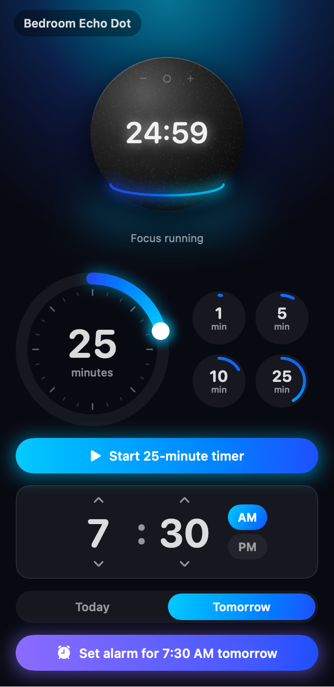

# AlexaAssist

A menu bar controller for your Echo Dot: timers, alarms and reminders from your Mac.

> **Unofficial.** Not affiliated with, endorsed by, or supported by Amazon. It uses the same private web API as the
> Alexa app, so it may stop working whenever Amazon changes that API.

<p align="center"></p>

## Features

- **Menu bar only.** No Dock icon and no main window. Left-click the icon for the panel, right-click for a menu
  (Open, Settings, Stop Ringing, Sign Out, Quit).
- **Timers.** Drag the dial (1 to 120 minutes) or use the one-click 1 / 5 / 10 / 25 minute presets, with an optional label.
  The running timer counts down in the menu bar and on the Echo Dot in the panel.
- **Alarms.** Pick a time, then once on any of the next seven days, or repeating daily, on weekdays or on weekends.
  Times that have already passed today can't be chosen.
- **Reminders.** Type what to be reminded about and pick a time; the text and time go to Alexa together.
- **Upcoming.** Every timer, alarm and reminder on the account, with a cancel button.
- **Ask Alexa anything.** Type any request ("what's the weather", "turn off the lights") and the Echo answers out loud.
- **Volume.** Press the speaker button for a slider that sets the Echo's volume.
- **Stop ringing.** Right-click the menu bar icon and choose **Stop Ringing** to silence an alarm or timer going off on the Echo.
- **Real confirmation.** After each action the app re-reads Alexa's list and only reports success once the new item is there.
- Everything is created on Alexa itself, so it also shows up in the Alexa phone app.

## Requirements

- macOS 15 or later
- Xcode 16 or later (to build)
- An Amazon account with an Echo device set to **English**. Your Amazon site (amazon.com, .co.uk, .de, .in, ...) is
  detected automatically.

## Build and run

1. Clone the repository and open `AlexaAssist.xcodeproj`.
2. Select the **AlexaAssist** scheme with **My Mac** as the destination and press **⌘R**.
3. Look for the speaker icon in the menu bar. The app has no window, so nothing else appears.

### First run

1. The panel opens with **Sign in with Amazon**. Sign in on Amazon's own page (password, one-time code, and a
   puzzle if Amazon shows one). Your password never passes through AlexaAssist.
2. If macOS asks whether AlexaAssist may use your Keychain, choose **Always Allow**. Locally built copies are not signed
   with a stable identity, so macOS asks again after each rebuild.
3. Pick your Echo at the top of the panel and start a timer.

To launch it at login, right-click the icon, choose **Settings…**, and turn on **Launch at login**.

## Built with

No third-party dependencies: everything is Apple's own frameworks.

| Technology | Used for |
|---|---|
| **Swift 6** (strict concurrency) | The whole app |
| **SwiftUI** + **Observation** (`@Observable`) | The panel, timer dial, time wheel, day strip, settings and sign-in screens |
| **AppKit** (`NSStatusItem`, `NSPopover`, `NSMenu`, `NSHostingController`) | The menu bar icon and countdown, the popover panel, the right-click menu, windows |
| **`LSUIElement`** (agent app) | No Dock icon and no app-switcher entry |
| **Swift Concurrency** (`async`/`await`, `actor`, `Task`) | All network calls go through one `actor`, so session refreshes never race |
| **WebKit** (`WKWebView`, non-persistent `WKWebsiteDataStore`) | Showing Amazon's own sign-in page, separate from Safari |
| **CryptoKit** (SHA-256) | The PKCE code challenge for Amazon sign-in |
| **Security** (Keychain Services) | Storing the Amazon refresh token |
| **Foundation** (`URLSession`, `JSONSerialization`, `Codable`) | Talking to Amazon with an ephemeral session and hand-managed cookies |
| **OSLog** (`Logger`) | Logs in Console.app, with no tokens or personal data |
| **ServiceManagement** (`SMAppService`) | Launch at login |
| **Swift Testing** | Unit tests for command wording, Amazon response parsing and sign-in URLs |
| **Xcode 16** | Project, build and tests |

## Amazon sign-in

AlexaAssist signs in the same way the Alexa iOS app does, following the open-source libraries credited below.
Your password and one-time code are only ever typed into Amazon's own page.

1. **New device identity.** Each sign-in creates a random device serial, a random PKCE verifier and its SHA-256
   challenge. The OAuth client ID is the hex of `<serial>#A2IVLV5VM2W81`, the Alexa iOS app's device type.
2. **Amazon's sign-in page.** `https://www.amazon.com/ap/signin` (OpenID 2.0 with the OAuth 2 extension,
   scope `device_auth_access`) opens in a private web view. A few cookies the Alexa app also sets (`frc`, `map-md`,
   `amzn-app-id`) are pre-set so Amazon shows fewer captchas.
3. **Authorization code.** When sign-in (including the one-time code) succeeds, Amazon redirects to
   `/ap/maplanding?openid.oa2.authorization_code=…`. The web view stops there and the app reads the code.
4. **Device registration.** `POST https://api.amazon.com/auth/register` exchanges the code and PKCE verifier for a
   **refresh token**. The app now appears as "…'s AlexaAssist" under *Your Devices* on Amazon.
5. **Your Amazon site.** `GET https://alexa.amazon.com/api/welcome` returns the Alexa host for your account
   (for example `alexa.amazon.in`); Far East accounts use amazon.co.jp. Then `GET /api/users/me` returns your
   customer ID, which Alexa commands need.
6. **Saved.** The refresh token, Amazon site and customer ID are saved as one item in your login Keychain.

On every launch:

- `POST https://api.amazon.com/auth/token` (`requested_token_type=auth_cookies`) turns the refresh token into
  session cookies for your Amazon site. They live in memory only.
- The `csrf` cookie Alexa's web API requires is fetched from the first of a few Alexa pages that sets it, and sent
  back as a header on each request.
- If Amazon answers 401 or 403, the cookies are refreshed once. If that fails too, the app signs out and asks you to
  sign in again (the menu bar icon shows ⚠︎).

## Alexa actions

| Action | Request |
|---|---|
| Timers and alarms | `POST /api/behaviors/preview` running `Alexa.TextCommand` ("set a timer for 10 minutes") |
| Reminders | `PUT /api/notifications/null` with the reminder text and time |
| Upcoming list | `GET /api/notifications` (every minute while the panel is open, every 5 minutes otherwise) |
| Cancel | `DELETE /api/notifications/{id}` |
| Stop ringing | `POST /api/behaviors/preview` running `Alexa.DeviceControls.Stop` |
| Ask Alexa | `POST /api/behaviors/preview` running `Alexa.TextCommand` with your text |
| Volume | `Alexa.DeviceControls.Volume`; current level from `GET /api/devices/deviceType/dsn/audio/v1/allDeviceVolumes` |

## Privacy and security

- Your password and one-time codes are typed into Amazon's page only.
- Only the refresh token is stored, in the Keychain item `dev.alexaassist.amazon`. **Sign Out** deletes it.
- Amazon cookies are kept in memory and never touch the shared cookie store or Safari.
- Logs (Console.app, subsystem `dev.alexaassist`) contain endpoint names and status codes, never tokens or cookies.
- The only servers contacted are Amazon's.

## Limitations

- Commands are English sentences, so Echo devices set to other languages won't understand them.
- Repeating alarms show their time of day in the list, not which days they repeat on.
- Timers paused by voice don't appear in the list until they are resumed.

## Troubleshooting

| Symptom | What to do |
|---|---|
| The panel says "Session expired" or the menu bar shows ⚠︎ | Sign in again. Amazon sometimes revokes app sessions. |
| "No Echo with timers or alarms found" | Check that you signed in with the account the Echo is registered to. |
| "Alexa didn't confirm it" | Check the Alexa app. The command may have been misheard; press **Retry**. |
| Something else | Open Console.app, filter on `dev.alexaassist`, and include those lines in an issue. |

## Development

```
App/
  AlexaAssistApp.swift   App entry, status item, popover, windows
  AppModel.swift         UI state, polling, actions
  PanelView.swift        The panel
  EchoDotView.swift      The rendered Echo Dot and theme colors
  Controls.swift         Timer dial, time wheel, day strip, buttons
  SignInView.swift       Amazon sign-in web view
  SettingsView.swift     Settings window
  Alexa/                 Amazon sign-in, Keychain, API client, command wording
Tests/
  AlexaAssistTests.swift
```

Run the tests with **⌘U** in Xcode, or:

```sh
xcodebuild test -project AlexaAssist.xcodeproj -scheme AlexaAssist
```

The project uses Swift 6 with strict concurrency and has no third-party dependencies.

## Contributing

Issues and pull requests are welcome. Keep changes small and focused, run the tests before opening a pull request,
and never include tokens, cookies or personal data in issues, logs or test fixtures.

## Credits

The Amazon protocol details follow these open-source projects:

- [alexa-remote2 / alexa-cookie2](https://github.com/Apollon77/alexa-remote) (MIT)
- [aioamazondevices](https://github.com/chemelli74/aioamazondevices) (Apache-2.0), used by Home Assistant

## License

[MIT](LICENSE)
